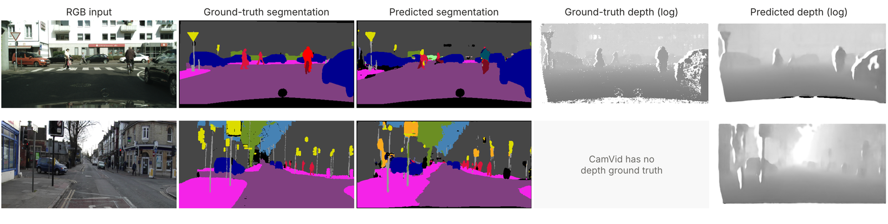
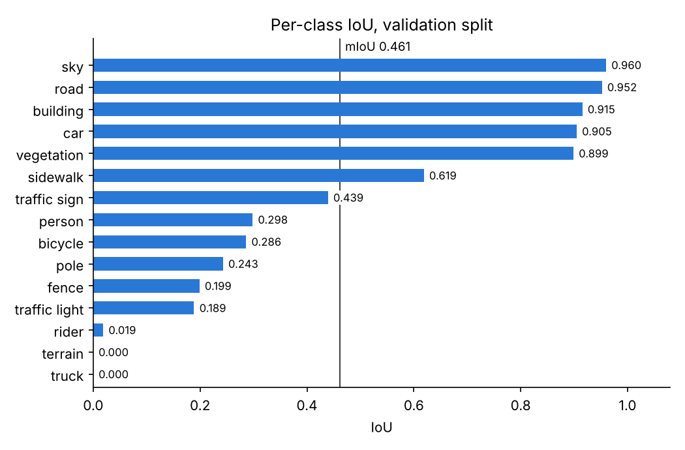
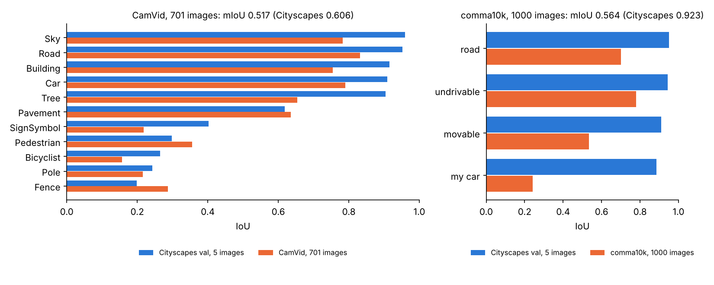
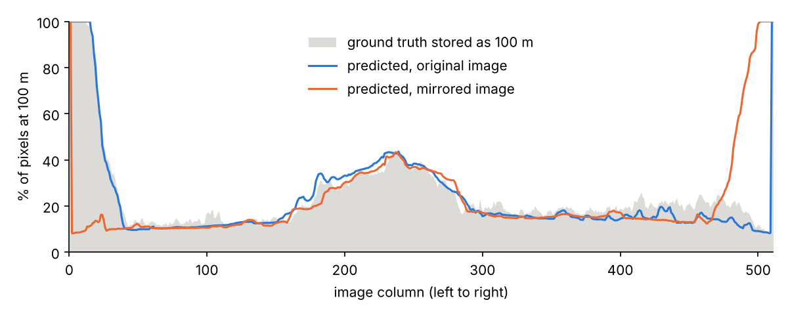

# Segmentation and depth from one network: inference test of a multi-task ResUNet

Course project for **MII226401 Computational Intelligence and Machine Learning** (Class B252), Magister Ilmu Komputer, Universitas Gadjah Mada.

**Osama Yehya Ghazal** · NIM 26/591650/PPA/07466 · Lecturer: Oskar Natan, S.ST., M.Tr.T., Ph.D.

The assignment was to run inference testing with a trained multi-task model that gives a semantic segmentation map (20 classes) and a depth map from one image. I ran the test sections of the course notebook and checked my numbers against the lecturer's log. Then I went a bit further: per-class IoU, standard depth metrics, a few robustness tests, and a bigger test on 1,701 public images from two other datasets.

- 📄 Report (3 pages): [`report/MTL_Inference_Report_Osama_Ghazal.pdf`](report/MTL_Inference_Report_Osama_Ghazal.pdf)
- 📓 Notebook: [`mtl_inference_test.ipynb`](mtl_inference_test.ipynb)


*Top: Cityscapes validation image. Bottom: CamVid image, which has no depth labels. Columns: input, ground-truth segmentation, predicted segmentation, ground-truth depth, predicted depth (log scale).*

## The model

ResUNet-MTL from the course notebook. One ResNet-34 encoder is shared by both tasks, and two U-Net style decoders produce the outputs: segmentation (20 channels, sigmoid, BCE loss) and depth (1 channel, ReLU, L1 loss). It has 27.78 M parameters and takes 512x256 images.

## Results

| Data | Images | Segmentation | Depth (valid pixels) |
|---|---|---|---|
| Cityscapes val (frankfurt) | 5 | IoU 0.872, mIoU 0.461 | MAE 5.28 m |
| Cityscapes test (berlin) | 5 | not measurable (placeholder labels) | MAE 4.65 m |
| CamVid, all three splits | 701 | mIoU 0.517 on 11 classes (Cityscapes: 0.606) | no depth labels |
| comma10k, first 1,000 frames | 1,000 | mIoU 0.564 on 4 classes (Cityscapes: 0.923) | no depth labels |

- The course metric TM = (1 − IoU) + MAE is 0.196 on the validation images.
- Over the 10 unseen Cityscapes images, the depth RMSE is 12.05 m and the AbsRel is 0.269, and 83.7% of the pixels are within 25% of the true depth.
- One image takes about 0.3 s on my laptop's CPU.
- None of the CamVid or comma10k images was used in training.

Big classes like road, sky and building reach about 0.9 IoU, while thin or rare ones like pole, traffic light and rider are much lower. That is why the mIoU is far below the pooled IoU.





## Things I found

- **A missing `model.eval()`.** My test numbers were up to 0.0006 off the lecturer's log. Cell 30 of the course notebook runs the model in training mode, so BatchNorm updates its statistics on one image before the test loop. When I copy that step, I get the log back to within 1e-7.
- **The test IoU of 0.041 is not a failure.** Cityscapes never released its test labels. The berlin label files only contain IDs 0, 1 and 3, which all map to "None". Depth can still be tested there because the disparity maps are real.
- **BGR input is correct.** `cv2.imread` gives BGR while the normaliser uses RGB ImageNet values, but feeding RGB drops the IoU from 0.872 to 0.817. The model was trained on BGR.
- **The depth head learned the camera's blind spot.** The stereo camera has no depth on the left edge, and the code stores missing depth as 100 m. In the left 32 columns, the model predicts 90 m or more for 78.5% of the pixels, whatever the image shows. If I mirror the image, the depth error on the right edge jumps from 3.7 m to 71.7 m.
- **The segmentation head learned where the bonnet usually is.** On comma10k it calls 69.2% of the car's hood "None" in the bottom 16 rows, where the Cityscapes bonnet sits, but 71.7% of it "road" higher up. On CamVid it calls 35% of the bottom rows "None", although they are 79% road.
- **Robustness.** Lighting barely matters, but noise, blur and strong JPEG compression hurt a lot (IoU 0.69, 0.84 and 0.63). All numbers are in [`results/extra_experiments.csv`](results/extra_experiments.csv).


*Share of pixels at 100 m in each image column (validation average). The grey area is the ground truth stored as 100 m. The orange line is the prediction for the mirrored image, flipped back.*

## How to run

1. Put the course files next to the notebook: `cityscapes/`, `trained_model/best_model.pth` and `resunet_mtl_0/`. They come from the course Google Drive and are not in this repo.
2. Install the packages with `pip install -r requirements.txt`. You also need git for the dataset downloads.
3. Open `mtl_inference_test.ipynb` in VS Code or Jupyter and run all cells. Everything runs on CPU.

The first run downloads CamVid (about 180 MB) and the first 1,000 comma10k frames (about 670 MB) with git, so it takes a while. Without git, those two parts are skipped and the rest still runs.

```
.
├── mtl_inference_test.ipynb
├── cityscapes/            course files (not included)
├── trained_model/         course files (not included)
├── resunet_mtl_0/         course files (not included)
├── SegNet-Tutorial/       CamVid, downloaded by the notebook
├── comma10k/              downloaded by the notebook
└── outputs/               figures and CSV logs written by the notebook
```

## What's in this repo

- `mtl_inference_test.ipynb`: the lecturer's test code plus my checks and experiments
- `report/`: the 3-page PDF report
- `figures/`: the figures used in this README
- `results/`: per-image results for the validation and test images, and the extra experiments

## Data and credits

- The model, data loader and helper functions come from the course notebook `mtl_seg_dep_colab.ipynb` by Oskar Natan (MII226401, Universitas Gadjah Mada).
- Cityscapes: M. Cordts et al., "The Cityscapes Dataset for Semantic Urban Scene Understanding", CVPR 2016. The dataset is not included because its license does not allow redistribution. Only a few example frames appear in the figures.
- CamVid: G. J. Brostow et al., "Semantic Object Classes in Video: A High-Definition Ground Truth Database", Pattern Recognition Letters 2009, using the SegNet-Tutorial version (CC BY-NC 4.0).
- comma10k: comma.ai, MIT licence.
